<div align="center">



<br/><br/>

<a href="https://www.linkedin.com/in/diegomichelsen"></a>
<a href="mailto:diegorodriguesmichelsen@gmail.com"></a>


</div>

<br/>

## Sobre mim

Mais de **10 anos em Operações**, os últimos dedicados a encontrar gargalos e eliminá-los com automação. Hoje atuo como **Analista de Suporte N3 com foco em Automação e Integrações**, construindo pipelines no n8n, integrações via APIs REST e webhooks, modelagem de dados no BigQuery e agentes de IA aplicados à operação.

Curso **Análise e Desenvolvimento de Sistemas** e uso este GitHub para documentar, com código e arquitetura, o tipo de solução que construo no dia a dia.

```yaml
cargo_atual:   Analista de Suporte N3 — Automação e Integrações
foco:          iPaaS, APIs REST, pipelines de dados, IA aplicada
formacao:      ADS (em curso) · Pós em Gestão Estratégica de Pessoas
idiomas:       Português (nativo), Inglês (profissional)
buscando:      Automação, Integrações, AI Ops, Dados
```

## Resultados que já entreguei

| Iniciativa | Impacto |
|---|---|
| Auditoria de qualidade com IA (n8n + OpenAI + Python) | Cobertura de auditoria de **~10% manual para ~90% automatizada** |
| CSAT justificado | IA separa falha humana de instabilidade sistêmica e gera abonos automáticos |
| Alertas operacionais | Pipelines com carga incremental no BigQuery e alertas no Slack a cada 6h |
| Hub de inteligência operacional | Portal web em código substituindo dashboards estáticos |

## Stack

<div align="center">

<br/><br/>


<br/>


<br/>


</div>

## Portfólio em construção

Cinco projetos que simulam a operação de uma empresa fictícia, com dados sintéticos, testes e arquitetura documentada.

| Projeto | O que resolve | Stack | Status |
|---|---|---|---|
| [**AI Support Intelligence**](https://github.com/diegomichelsen/ai-support-intelligence) | Auditoria de atendimentos com IA, scoring, CSAT justificado e contestações | Python, FastAPI, PostgreSQL, n8n, Docker | 🟡 Em desenvolvimento |
| [**LeadFlow AI**](https://github.com/diegomichelsen/leadflow-ai) | Captação, deduplicação e qualificação de leads com integração a CRM | n8n, Python, Webhooks | ⚪ Planejado |
| [**Finance Intelligence**](https://github.com/diegomichelsen/finance-intelligence) | Conciliação financeira e detecção de divergências | Python, SQL, PostgreSQL | ⚪ Planejado |
| [**Operational Intelligence Hub**](https://github.com/diegomichelsen/enterprise-operational-intelligence-hub) | KPIs de todas as áreas em uma interface única | HTML, JS, Python, SQL | ⚪ Planejado |
| [**Automation Control Tower**](https://github.com/diegomichelsen/automation-control-tower) | Observabilidade das automações: falhas, retentativas e incidentes | FastAPI, PostgreSQL, n8n | ⚪ Planejado |

## Certificações

<div align="center">


<br/>


</div>
